# e-Clinic — Web client (Angular)

[](https://github.com/HussainALAradi5/e_clinic_client/actions/workflows/tests.yml) [](LICENSE)

## Live demo

| | Address |
|---|---|
| Web app (staff and patient portal) | https://e-clinic-web.onrender.com |
| API | https://e-clinic-api.onrender.com |

Free Render instances sleep when idle: the first visit can take about a minute to wake the API. Demo accounts
(one per role: patient, receptionist, doctor, nurse, pharmacist, cashier, accountant, HR, admin) are available on
request.

**Screenshots:** every role and feature in light and dark — [below](#screenshots)
(staff chat, support tickets, notifications, front desk, clinic, billing, pharmacy, HR, accounting, admin).

---

## What it is

The web client of **e-Clinic**, a clinic management system: one Angular app with a **staff workspace** (front desk,
doctors, nurses, pharmacy, cashier, accountant, HR, admin — each sees the pages their role allows) and a **patient
portal** (visits and booking, results, prescriptions, invoices, messages, profile). It talks to the
[Laravel API](https://github.com/HussainALAradi5/e_clinic_server); the [Flutter app](https://github.com/HussainALAradi5/e_clinic_mobile)
uses the same API.

| | |
|---|---|
| Framework | Angular 21 (standalone components, signals, OnPush), Angular Material 21, Tailwind CSS 4, NgRx Signals |
| Structure | Layer first: `components`, `pages`, `services`, `interfaces`, `enums`, `constants`, `utilities`, `validations`, `middlewares`, `config` — each with module folders; one endpoint map (`config/endpoints.ts`), UI text in constants |
| Lists | One generic list page driven by the server's schema: search, filters, saved views, sorting, paging, bulk actions, Excel import / export — all on the server |
| Features | Booking with free slots, check-in by QR code, visit workspace, results with images, pharmacy dispensing, invoices with payment state and paid-by filters, cash desk, journal entries, payroll, staff chat (websockets), support tickets, notifications with browser push and a sound per kind, light and dark themes |
| Quality | Strict TypeScript, unit tests (Vitest), a smoke run over every page for every role |

<!-- hierarchy:start -->
## Hierarchy

### Routes and layouts

```mermaid
flowchart TD
    app["AppComponent · app.routes.ts"]:::root
    app --> pub["PublicLayout  /  (public website, /verify)"]:::layout
    app --> auth["AuthLayout  /login …  (guestGuard)"]:::layout
    app --> print["/print/…  (authGuard) — printable documents"]:::layout
    app --> portal["PortalLayout  /portal  (authGuard · patientGuard)"]:::layout
    app --> shell["ShellLayout  /  (authGuard · staffGuard)"]:::layout
    portal --> pm["modules/portal — visits, booking, results, invoices, profile"]:::module
    shell --> dash["/dashboard"]:::module
    shell --> sys["modules/system  /system — users, roles, audit, scan …"]:::module
    shell --> cli["modules/clinic  /clinic — patients, visits, doctors, rooms …"]:::module
    shell --> bil["modules/billing  /billing — invoices, payments, fees, packages …"]:::module
    shell --> pha["modules/pharmacy  /pharmacy"]:::module
    shell --> hr["modules/hr  /hr — staff, attendance, leaves, payroll, earnings"]:::module
    shell --> acc["modules/accounting  /accounting — journal, reports, month summary"]:::module
    shell --> com["modules/communication  /chat · /support"]:::module
    shell --> ref["modules/reference  /reference"]:::module
    classDef root fill:#0f3d3e,color:#fff,stroke:#0f3d3e
    classDef layout fill:#e6f4f1,stroke:#2f7d6d,color:#0f3d3e
    classDef module fill:#fff,stroke:#9fb8b2,color:#0f3d3e
```

Every area is lazy: its route file is downloaded only when its guard (`accessGuard('<right>')`) lets the user in. Refused →
home page with an "Unauthorized access" toast (see `services/auth/access-notice.service.ts`).

### How a screen reaches the API

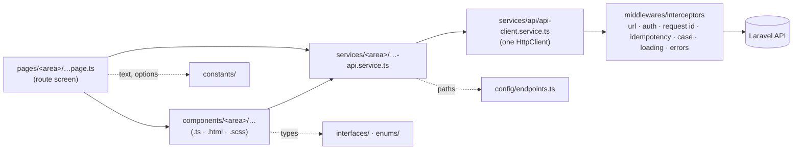

### Folders (layer first, then area)

```text
src/app/
├── app.ts · app.html · app.config.ts · app.routes.ts   ← root: providers, interceptors, top routes
├── config/          3 files  ← API base URL, endpoint map, date format
│       date
├── modules/        15 files  ← thin lazy route files per area (no logic)
│       accounting · billing · clinic · communication · hr · pharmacy · portal · public · reference
│       system
├── pages/         258 files  ← routed screens (…Page); compose components
│       accounting · billing · clinic · common · communication · dashboard · dev · hr · pharmacy
│       portal · public · reference · system
├── components/    390 files  ← reusable UI, one folder per component (.ts + .html + .scss)
│       accounting · billing · clinic · common · communication · documents · hr · layout · notification
│       pharmacy · portal · reference · settings · system
├── services/       96 files  ← API calls and state; one ApiClient
│       accounting · api · attachment · auth · billing · clinic · code · communication · data
│       documents · finance · hr · identity · notification · pharmacy · portal · reference · system
│       task · ui · upload · view
├── middlewares/     4 files  ← route guards and HTTP interceptors
│       guards · interceptors
├── interfaces/    399 files  ← one type per file (wire DTOs and UI types)
│       accounting · api · attachment · auth · billing · bulk · clinic · code · common · communication
│       dev · documents · finance · hr · identity · list · notification · pharmacy · portal · public
│       reference · system · task · ui · upload · view
├── enums/         109 files  ← enums mirrored from the server
│       accounting · api · attachment · auth · billing · clinic · code · communication · documents
│       finance · hr · identity · list · notification · pharmacy · reference · shared · task · ui
│       upload
├── constants/     141 files  ← every UI text, option list and limit
│       accounting · billing · clinic · common · communication · dashboard · dev · documents · hr
│       layout · notification · pharmacy · portal · public · reference · settings · system · ui
├── utilities/      45 files  ← pure helpers (money, dates, lists)
│       accounting · billing · clinic · communication · hr · ui
├── validations/     1 files  ← reusable form validators
├── directives/      2 files  ← shared directives (tap motion …)
└── pipes/           7 files  ← shared pipes (money, enum label …)
```
<!-- hierarchy:end -->

## Run it locally

```bash
npm install
npm start          # http://localhost:4200 — expects the API on http://localhost:8000 (see e_clinic_server)
```

## Tests and build

```bash
npx ng test --watch=false
npx ng build
```

The first download is about 640 kB (about 160 kB compressed): Angular, the router, Angular Material and the
styles. Every page is lazy-loaded on top of it. The size budget in `angular.json` warns above 700 kB and fails the
build above 1 MB, so real growth still shows up.

## Screenshots

The main screens from the running web app with the demo data, in light and dark.

| Screen | Light | Dark |
|---|---|---|
| Public site |  | 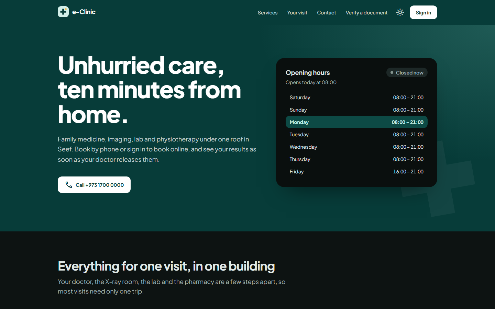 |
| Appointments and filters | 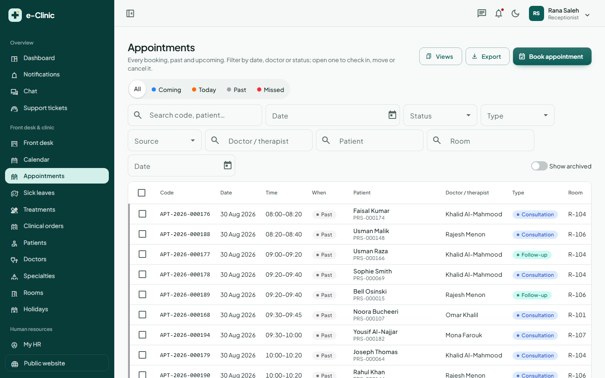 | 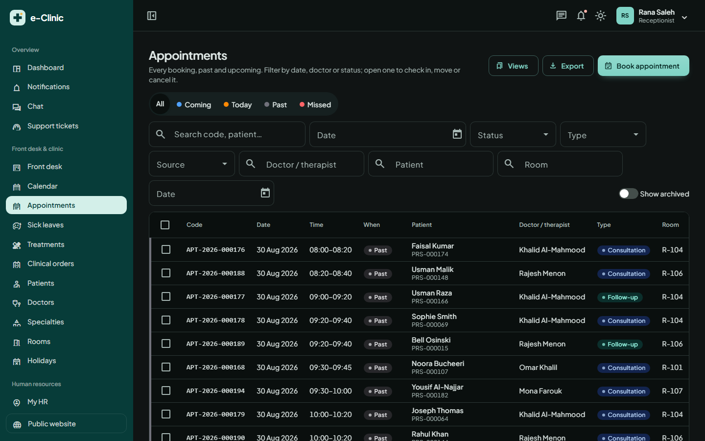 |
| Appointment with badges and event log | 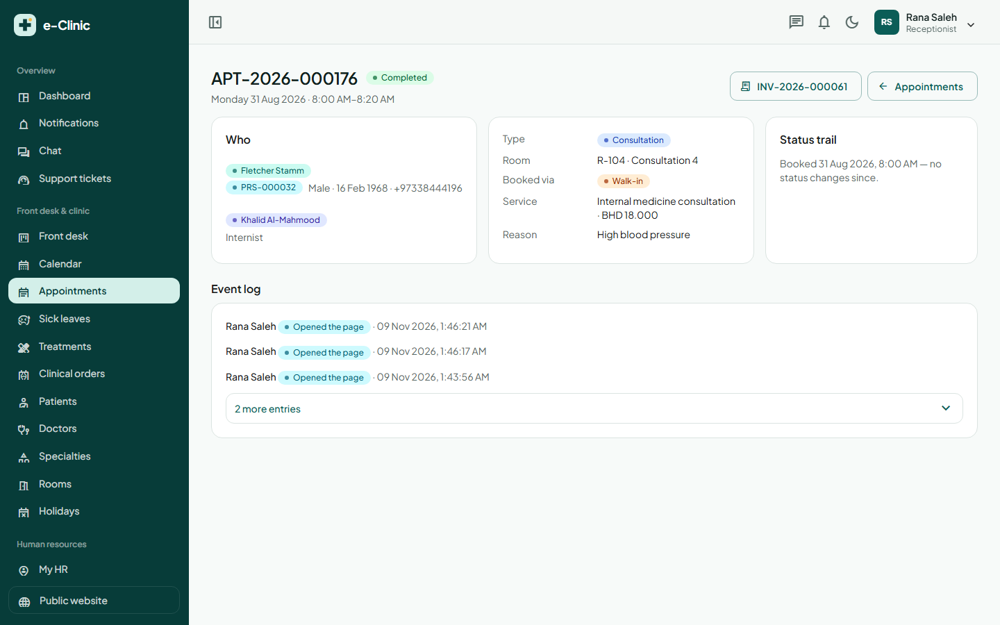 | 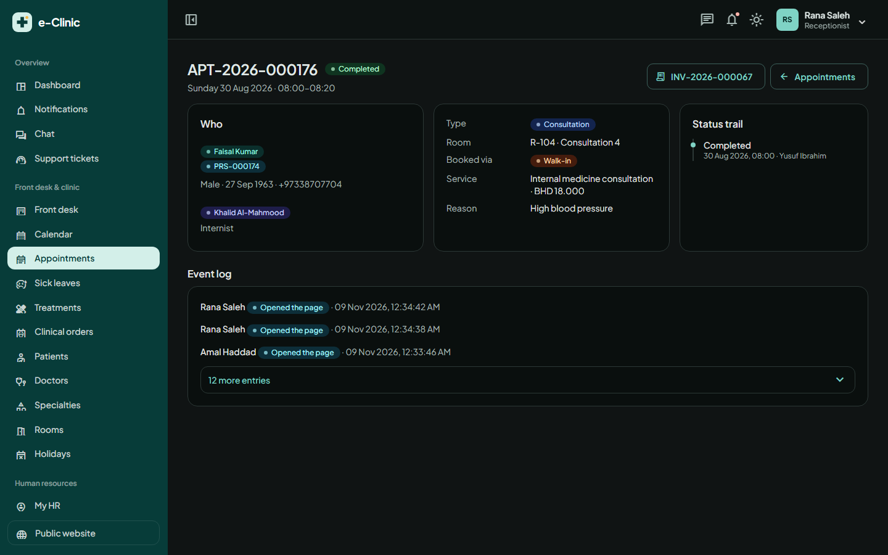 |
| Patient file event log | 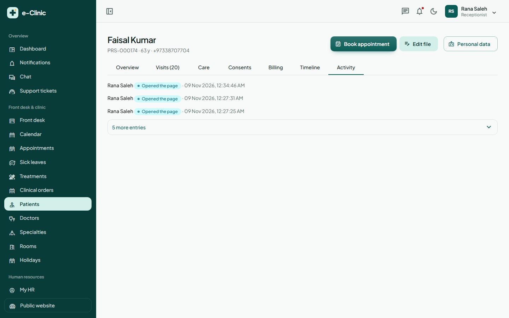 | 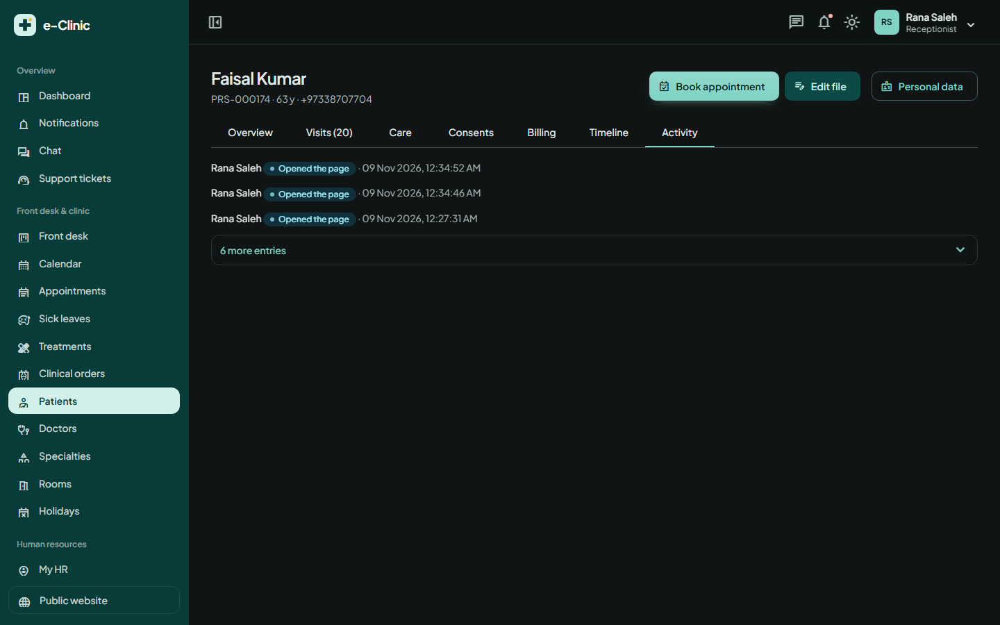 |
| Doctor dashboard | 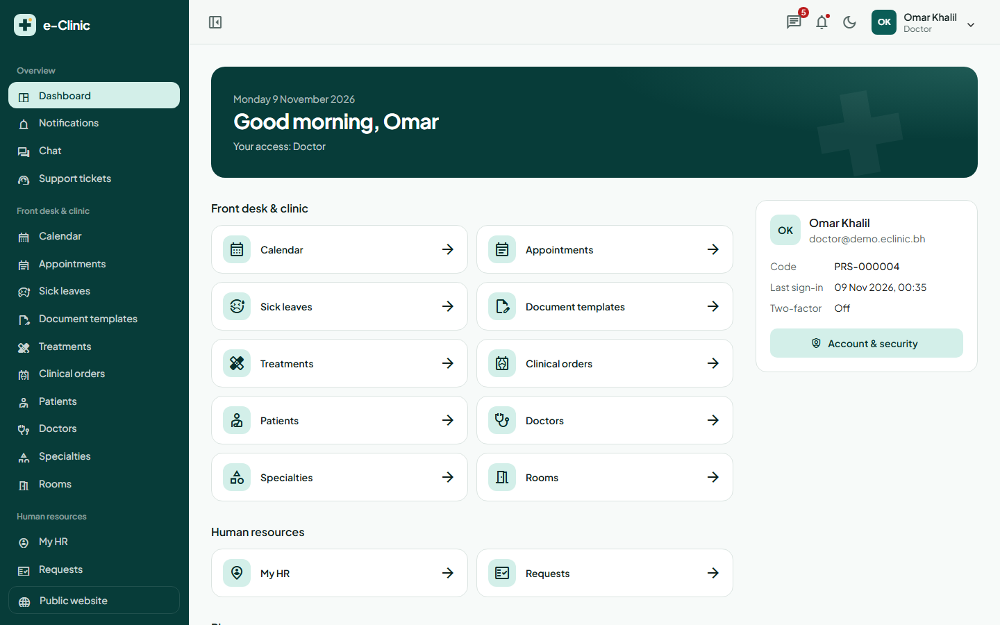 | 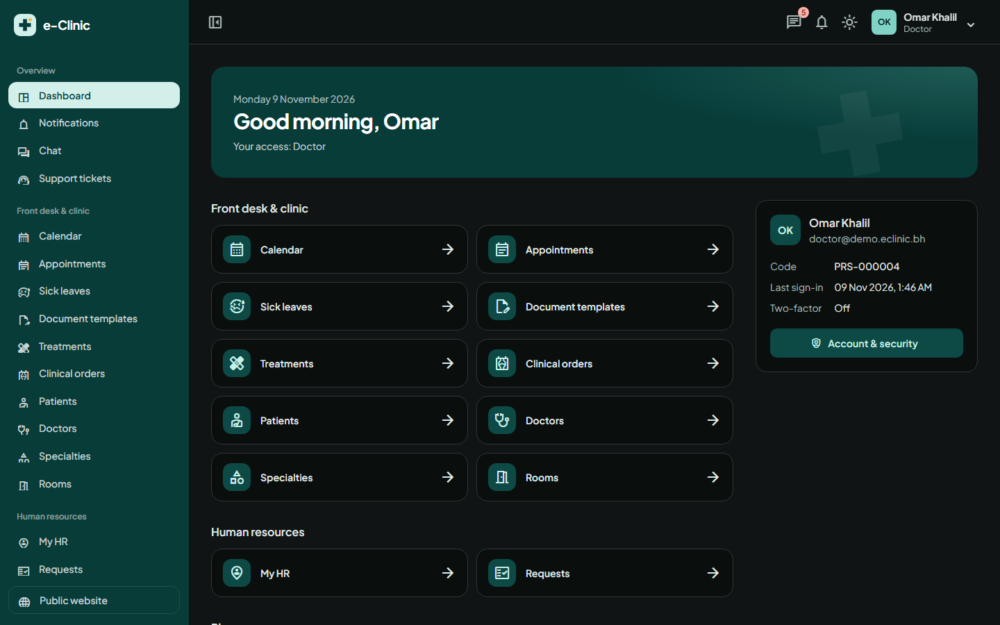 |
| Attendance | 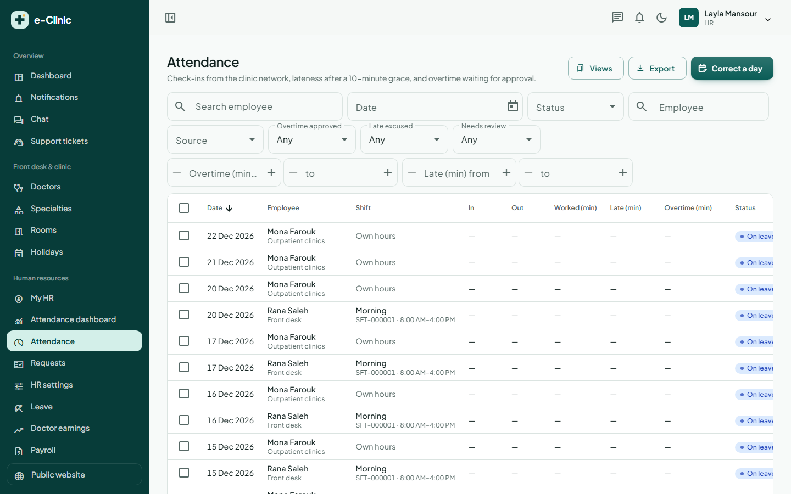 | 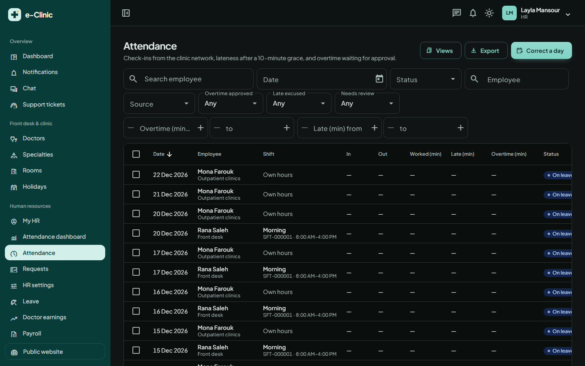 |
| Invoice | 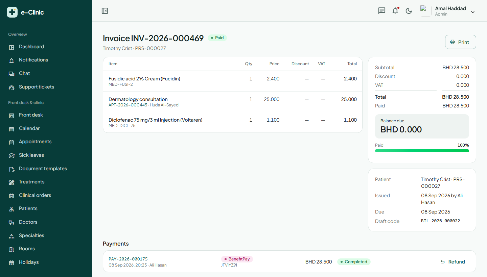 | 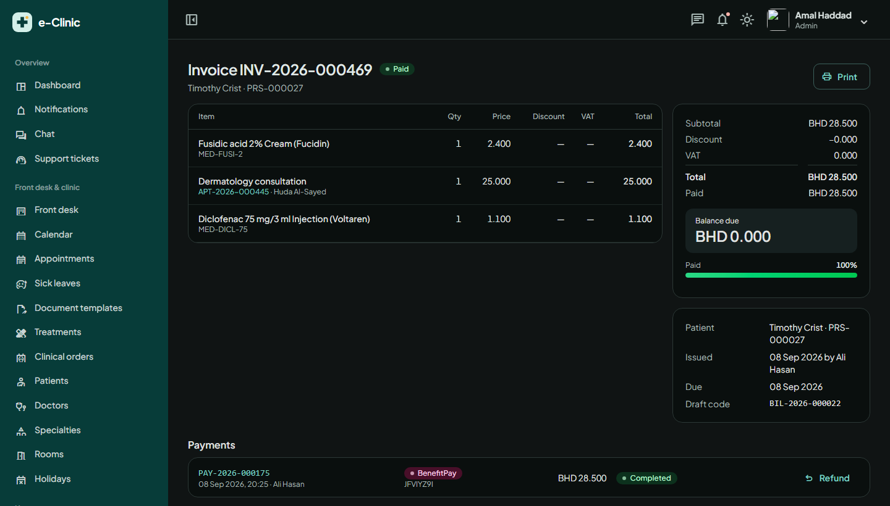 |
| Patient portal | 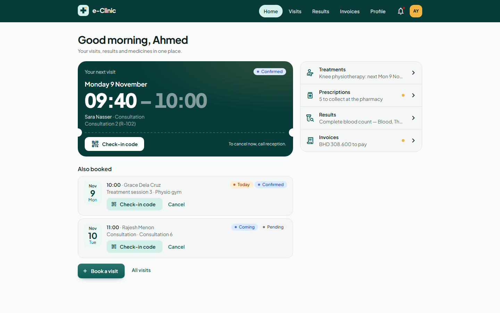 | 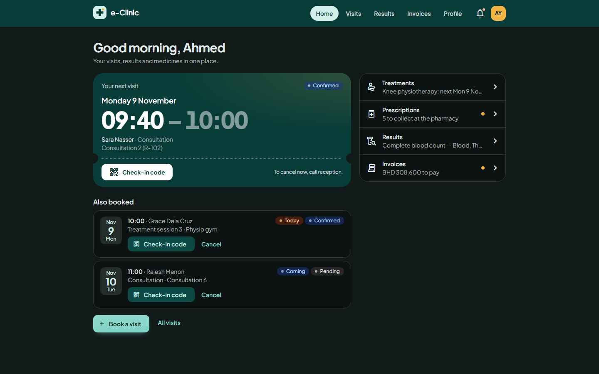 |

## Licence

[MIT](LICENSE)
